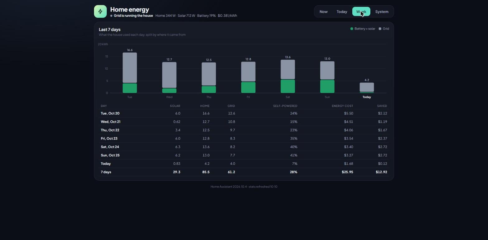
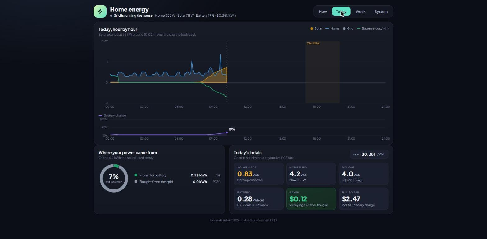
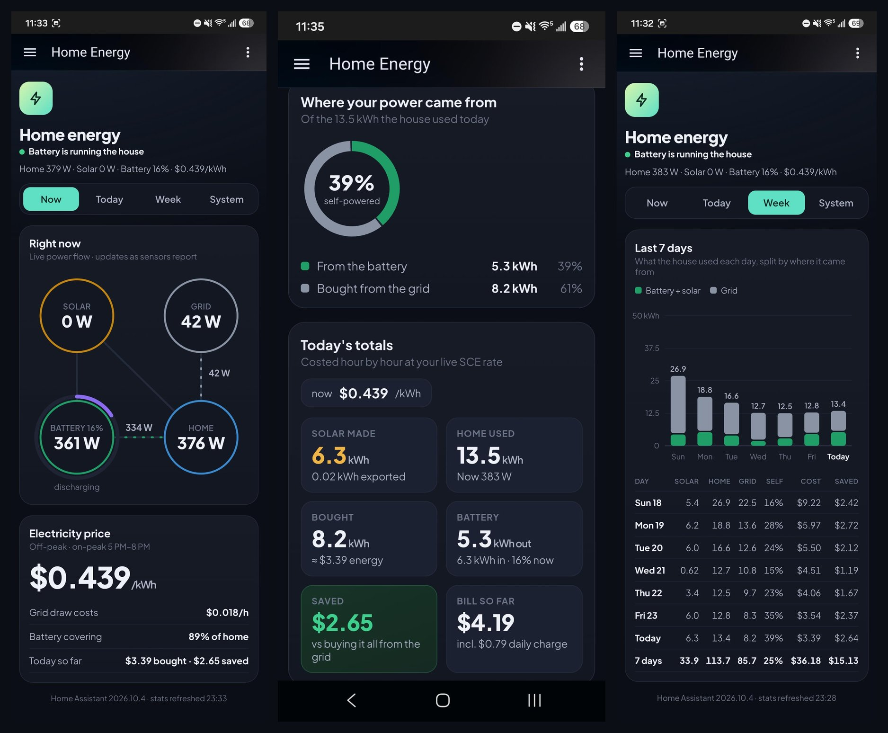

# ZeroSpill: battery-buffered zero-export solar

<p align="center"><a href="https://buymeacoffee.com/jakeshake"></a></p>

A DIY, battery-buffered solar system that feeds **only what the house is using**. It never intentionally exports to the grid, and it shifts stored solar into expensive time-of-use (TOU) hours. Everything runs locally in Home Assistant, with no cloud dependency.

> ⚠️ **Read [Safety & Legal](docs/safety-and-legal.md) before you buy anything.**
> This is **not** a UL 3700-listed plug-in ("balcony") solar kit. It does **not** qualify for California's SB 868 plug-in solar exemption or similar state laws. It connects a microinverter to a dedicated 240 V circuit and runs it from a DIY battery bus. This is a build log for experienced DIYers. Read the trade-offs and decide for yourself.

## What it does

- **True zero export.** A Home Assistant controller sets the Hoymiles power limit from real grid readings (Emporia Vue Utility Connect), cuts output fast on export, and raises it slowly. It targets a small (~30–50 W) import buffer instead of pushing power back to the utility.
- **Time shifting.** Solar charges a 48 V LiFePO4 battery during the day. The inverter covers house load during peak (5–8 pm on SCE TOU-D-5-8PM) and overnight.
- **Forecast-aware.** A Solcast-driven overnight hold and dispatch plan aims to have the battery full by end of production without wasting solar.
- **Local failsafes.** The BMS-reader ESP32 enforces a low-SoC discharge cutoff and a cold-charge lockout even if Home Assistant or the network is down.
- **Real numbers.** See [Results](#results).

## Who this is for

This build is a good fit if you have **all** of these:

- Space for ~1,200 W of panels with decent sun
- An **unused 240 V receptacle on a dedicated circuit** that you have verified is wired correctly (see [AC connection](docs/build-guide.md#5-ac-connection))
- A utility smart meter the Emporia Vue Utility Connect supports (see [Metering](docs/build-guide.md#7-grid-metering))
- Comfort with DC battery wiring, crimping, flashing ESP32s, and Home Assistant YAML

If you want something you can buy, plug into a 120 V outlet, and stay within your state's plug-in solar law, buy a **UL 3700-listed kit** instead. This project is for people who want battery time-shifting and full local control and accept the trade-offs.

## Architecture

```
 6× 200 W panels (3S2P)
          │
  Victron SmartSolar MPPT 150/35 ──BLE──► HA (via ESP32 Bluetooth proxy)
          │
   48 V LiFePO4 (JBD BMS) ──BLE──► ESP32 (ESPHome): SoC, failsafes
          │
   MRBF fuse → pre-charge rotary switch → 30 A DC breaker
          │
   Hoymiles HM-1200NT ◄──NRF24── ESP32-S3 (OpenDTU-OnBattery) ◄──MQTT── HA controller
          │                                                          ▲
   6-20P → dedicated 240 V circuit ──► house ──► utility meter ──Zigbee──► Emporia Vue (ESPHome)
                                                  (optional) Sonoff S31: appliance metering
```

## Docs

| Doc | What's in it |
|---|---|
| [Safety & Legal](docs/safety-and-legal.md) | SB 868 / UL 3700, what this is and isn't, the hazards |
| [Parts list](docs/parts-list.md) | Full BOM, with notes on what matters |
| [Build guide](docs/build-guide.md) | Panels, DC wiring, pre-charge, AC connection, DTU, BMS, metering |
| [Home Assistant](docs/home-assistant.md) | Controller logic, package install, blueprint, dashboard |
| [Troubleshooting](docs/troubleshooting.md) | Real problems hit during this build and how they were fixed |

Config files: [`esphome/`](esphome/) · [`home-assistant/`](home-assistant/)

## Results

Real numbers from the author's system in Oxnard, CA (SCE TOU-D-5-8PM, ~5 kWh pack, 6 × 200 W panels on an HM-1200NT), late October 2026.

| Metric | Value |
|---|---|
| Solar yield, sunny late-October day (6 panels) | ~6.0–6.3 kWh/day |
| Share of house load covered by solar + battery | 35–41 % on those days (28 % over a week that included cloudy days) |
| Value saved at SCE TOU rates | ~$2.40–2.70/day on sunny days; $12.92 over 7 days |
| Grid export | Effectively zero. Only brief spikes when big loads switch off; an alert fires at > 6 Wh per 10 min |

Expect summer yield to be higher and winter lower. These are a handful of autumn days, not an annual figure.




The same dashboard on a phone (Home Assistant companion app): live power flow, today's totals, and the 7-day view. It works on narrow screens with no sideways scrolling.



If ZeroSpill saves you money on your power bill, consider [buying me a coffee](https://buymeacoffee.com/jakeshake).

## Credits

- [OpenDTU-OnBattery](https://github.com/hoylabs/OpenDTU-OnBattery)
- [esphome-emporia-vue-utility](https://github.com/nekorevend/esphome-emporia-vue-utility) by nekorevend
- Home Assistant, ESPHome, Solcast integration authors

## License

Configs and code (`esphome/`, `home-assistant/`): [MIT](LICENSE). Docs and images: [CC BY-SA 4.0](https://creativecommons.org/licenses/by-sa/4.0/).

**No warranty.** You are responsible for your own installation, local code compliance, and utility rules.
